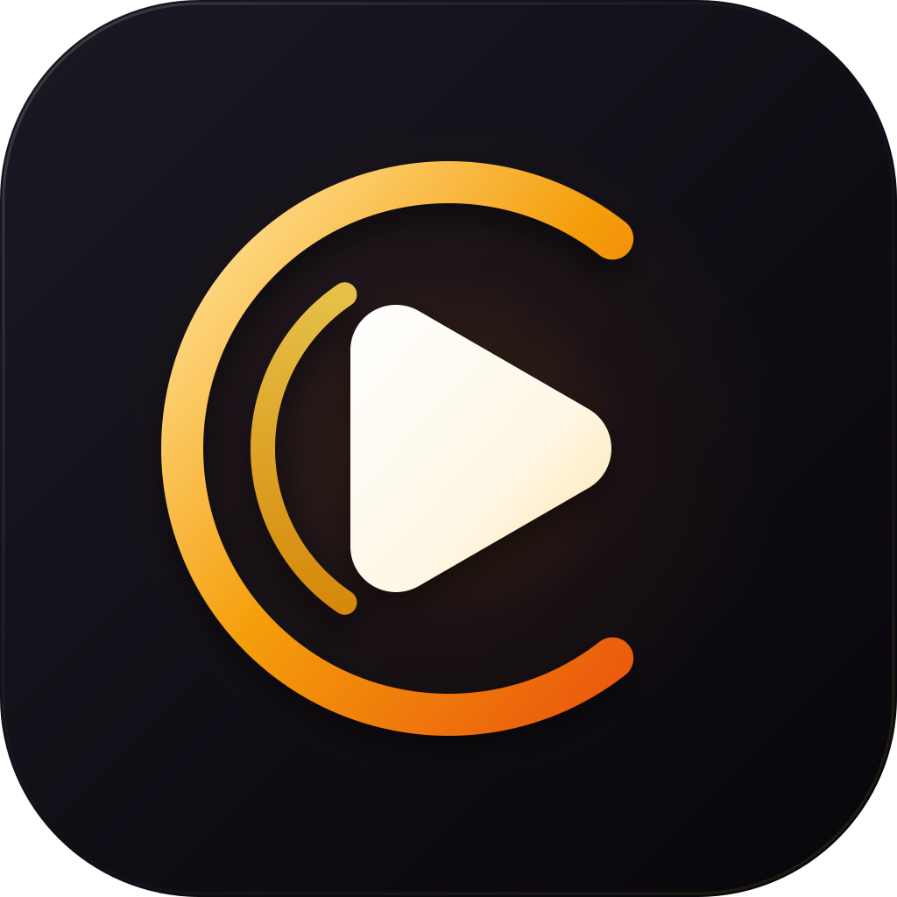

<p align="center">
  
</p>

# Wetar

> **A fast, lightweight, 100% offline, deeply customizable local music player for Android, iOS, and macOS — built with Flutter.**


Wetar puts **your local files** and **your personal taste** first. It scans only the folders you explicitly choose, stays completely offline with zero network permissions or telemetry, and lets you customize colors, typography, player layouts, backgrounds, and gestures from one unified design engine.

---

## Core Principles

1. **Strict Folder Whitelist**
   - Only audio files inside folders you explicitly select appear anywhere in Wetar (library, search, playlists, stats, or widgets).
   - Wetar **never modifies or deletes** your audio files. Removing a folder removes it from the active library view while preserving favorites, play counts, and playlist references safely if the folder returns.
2. **100% Offline & Zero Network**
   - Android release builds strip `INTERNET`, `ACCESS_NETWORK_STATE`, and `ACCESS_WIFI_STATE`.
   - macOS release entitlements declare sandboxed user-selected file/bookmark access only (no network client/server entitlements).
   - iOS ships a verified `PrivacyInfo.xcprivacy` declaring zero tracking and zero collected data.
   - All bundled fonts (`Cairo`, `Almarai`, `Alexandria`, `PlusJakartaSans`, `Jost`) are local assets (`1.4 MB` total).
3. **Lightweight & Responsive**
   - Cached SQLite (Drift) library loads cleanly on startup (`< 1s` target) before deferring incremental background folder reconciliation.
   - Fixed-extent slivers, LRU thumbnail resolution, `ResizeImage` decode bounds, and background `TickerMode`/position-stream pausing keep UI fluid and screen-off CPU near zero.
4. **Deeply Personalizable**
   - Tokenized theming via `WetarTokens` + versioned `AppearanceSettings`, 8 built-in Looks, `.wetarlook` import/export, live artwork color extraction in isolates, custom `.ttf`/`.otf` font loading, 9 background render modes, and 5 Now Playing layouts.

---

## Key Features

- **Music Folders & Incremental Scanning**
  - Android MediaStore folder discovery grouped by volume + manual SAF folder picker + per-folder subfolder inclusion/exclusion.
  - Apple (`macOS` / `iOS`) security-scoped bookmarks, background isolate tag scanning via `audio_metadata_reader`, macOS FSEvents live watching, Finder/Window drag-and-drop, and iCloud `.icloud` placeholder download triggers.
  - External *Open-With* tracks play cleanly in a temporary session without polluting your library.
- **Audio Engine & Playback (`WetarAudioHandler`)**
  - Single-source-of-truth `audio_service` + `just_audio` + `audio_session` pipeline with gapless playback, lock screen & media key controls, queue persistence across restarts, A–B loop, ReplayGain normalization, playback speed & pitch control, sleep timer, and Car Mode.
  - Native Android hardware Equalizer, Bass Boost, Virtualizer, and Loudness Enhancer (cleanly capability-gated where unavailable on Darwin).
- **Lyrics, Playlists & Wrapped Recap**
  - Embedded tag lyrics + attached/sidecar `.lrc` parser with tap-to-seek, sync offset adjustment, and per-line Arabic RTL / Latin LTR alignment.
  - User & Smart playlists (Most Played, Recently Added, Never Played, Long Tracks), M3U import/export, track card sharing, JSON local backup/restore, and Wetar Wrapped listening statistics.
- **Bilingual Arabic RTL & English LTR**
  - Instant in-app Arabic / English switching with Arabic-Indic or Western numerals and Arabic search normalization (tashkeel & alef/ya/ta marbuta normalization).

---

## Platform Matrix

| Platform | Min Version | Folder Access & Scanning | Background & OS Integration | Native EQ | Measured Release Output |
| :--- | :--- | :--- | :--- | :--- | :--- |
| **Android** | SDK 24 (Target 36) | MediaStore + SAF + JNI helpers | `MediaPlayback` foreground service, Home Widget, Open-With, Shortcuts | Yes (`AudioEffect` pipeline) | `12.3 MB` (`arm64-v8a` split APK) |
| **macOS** | macOS 12.0+ | `NSOpenPanel` + security bookmarks + FSEvents + isolate scanner | Sidebar desktop UI, Menu Bar, Shortcuts, Drag-and-Drop, Compact Mini-Player | Planned (`AVAudioEngine`) | `58.0 MB` (`wetar.app`, universal) |
| **iOS** | iOS 15.0+ | `UIDocumentPicker` + security bookmarks + iCloud check + isolate scanner | `UIBackgroundModes: audio`, Files app sharing, Open-With, Privacy Manifest | Planned (`AVAudioEngine`) | `24.6 MB` (`Runner.app`, unsigned) |

---

## Architecture & Project Layout

Wetar follows a **feature-first Clean Architecture** backed by `flutter_bloc`, `get_it`, `Drift` (SQLite), and `PlatformCapabilities` gating:

```text
lib/
├── main.dart                     # Minimal app entrypoint
├── core/
│   ├── app/                      # App bootstrap & root WetarApp widget
│   ├── capabilities/             # Runtime OS feature capability matrix
│   ├── database/                 # Drift SQLite schema & indexes
│   ├── di/                       # get_it service locator
│   ├── logging/                  # Offline rolling file & error guard logger
│   ├── platform/                 # Cross-platform interfaces & Method/Event channels
│   ├── router/                   # Adaptive mobile / desktop shell & shortcuts
│   ├── storage/                  # Bounded LRU cache directories
│   └── utils/                    # Arabic normalizer, numeral formatter, haptics
├── features/
│   ├── equalizer/                # Android native EQ, presets & frequency curve UI
│   ├── library/                  # Songs, albums, artists, genres, search & home
│   ├── lyrics/                   # LRC parser & synced lyrics sheet
│   ├── music_folders/            # Whitelist folders, SAF/bookmarks & isolate scanner
│   ├── onboarding/               # Guided setup, permissions & starting look
│   ├── personalization/          # WetarTokens, Looks, fonts, backgrounds & studio UI
│   ├── player/                   # WetarAudioHandler, queue, car mode & 5 player views
│   ├── playlists/                # Playlists, 2x2 collage covers & M3U import/export
│   └── settings/                 # Settings, JSON backup, Wrapped stats & diagnostics
└── l10n/                         # English & Arabic ARB localization resources
```

---

## Getting Started

### Prerequisites
- Flutter `3.50+` & Dart `3.14+`
- Android SDK `36` (for Android builds)
- Xcode & CocoaPods (for macOS and iOS builds)

### Common Commands

```bash
# Install packages & generate localizations
flutter pub get

# Verify formatting, static analysis, and unit/widget tests
dart format --output=none --set-exit-if-changed lib test
flutter analyze
flutter test

# Build release artifacts
flutter build apk --release --split-per-abi --target-platform android-arm64
flutter build macos --release
flutter build ios --release --no-codesign
```

### Offline Verification

```bash
# Android: confirm zero INTERNET / network permissions in release APK
aapt2 dump permissions build/app/outputs/flutter-apk/app-arm64-v8a-release.apk

# macOS: inspect sandbox entitlements
codesign -d --entitlements - build/macos/Build/Products/Release/wetar.app
```

---

## Documentation

- [Architecture Overview](docs/architecture.md)
- [Design System & Personalization Spec](docs/design_spec.md)
- [Platform Capabilities Matrix](docs/platform_capabilities.md)
- [Dependency Audit](docs/dependency_audit.md)
- [Darwin Native Equalizer Plan](docs/darwin_equalizer_plan.md)
- [Release, Store Privacy & CI Workflows](docs/release_and_ci.md)
- [Manual QA Checklist](docs/manual_qa_checklist.md)
